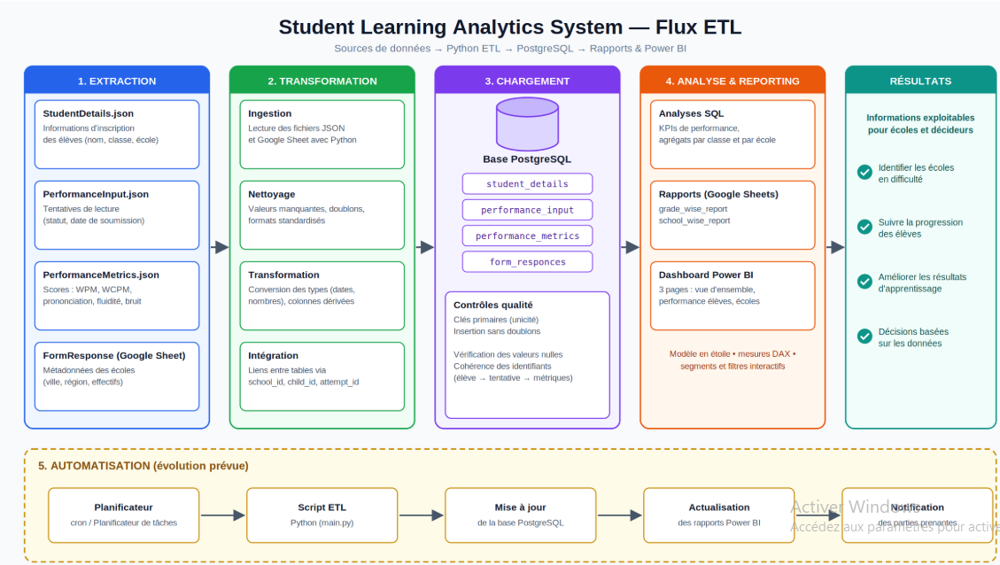
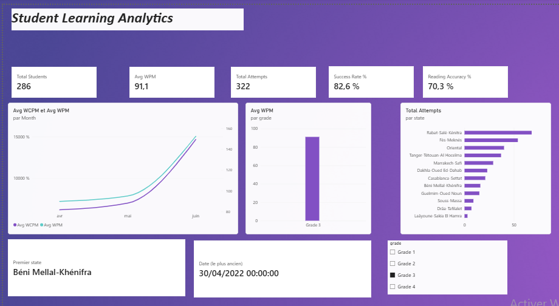
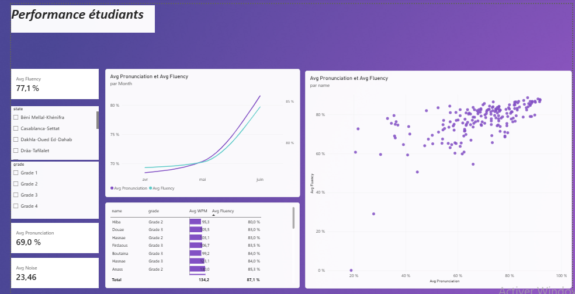
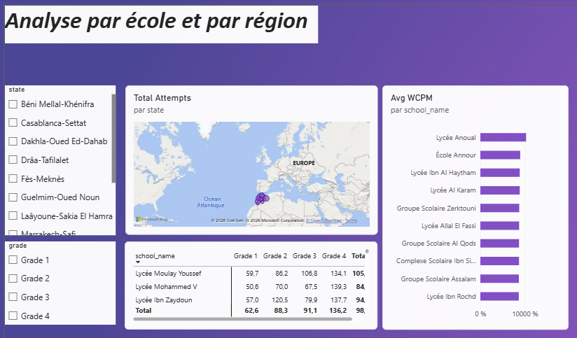

# 📚 Student Learning Analytics System

Pipeline de données de bout en bout pour analyser les performances de lecture d'élèves : **collecte (JSON + Google Sheet) → ETL Python → base PostgreSQL → rapports SQL → tableau de bord Power BI**.

> ℹ️ Toutes les données de ce dépôt sont **synthétiques** (jeu de données d'exercice). Aucune information réelle sur des élèves ou des écoles n'est incluse.



---

## 🎯 Objectif

Permettre aux écoles et aux décideurs de :

- identifier les écoles et les classes en difficulté ;
- suivre la progression de la lecture des élèves (vitesse, précision, prononciation, fluidité) ;
- comparer les performances par **classe**, par **école** et par **région** ;
- prendre des décisions à partir de données fiables et vérifiées.

## 🧱 Architecture

| Étape | Description | Outils |
|---|---|---|
| **1. Extraction** | Lecture de 3 fichiers JSON (élèves, tentatives, métriques) et d'un Google Sheet (écoles) | Python, `json`, `gspread`, **Google Cloud Platform** (compte de service + API Google Sheets) |
| **2. Transformation** | Mise en correspondance des champs, gestion des valeurs manquantes | Python |
| **3. Chargement** | Insertion dans PostgreSQL, sans doublons (`ON CONFLICT DO NOTHING`) | `psycopg2`, PostgreSQL |
| **4. Analyse & reporting** | Agrégats SQL, rapports Google Sheets, dashboard Power BI | SQL, Power BI, DAX |

### Modèle de données

| Table | Clé primaire | Contenu |
|---|---|---|
| `student_details` | `id` | Élèves (nom, classe, école) |
| `performance_input` | `attempt_id` | Tentatives de lecture (élève, date, statut) |
| `performance_metrics` | `metric_id` | Scores : WPM, WCPM, prononciation, fluidité, bruit |
| `form_responces` | `school_id` | Écoles (nom, ville, région, effectifs) |

Relations : `form_responces` → `student_details` → `performance_input` → `performance_metrics` (1 à plusieurs).
Le schéma SQL complet est dans [`sql/schema.sql`](sql/schema.sql).

## 📊 Tableau de bord Power BI

Le fichier [`powerbi/Student_Learning_Analytics.pbix`](powerbi) contient **3 pages** :

| Page | Contenu |
|---|---|
| **Vue d'ensemble** | KPIs (élèves, tentatives, taux de réussite, WPM moyen, précision de lecture), évolution mensuelle, comparaison par classe et par région |
| **Performance des élèves** | Fluidité, prononciation, bruit, nuage de points, Top 10 / Bottom 10 des élèves |
| **Écoles** | Carte des tentatives par région, classement des écoles, matrice école × classe |





### Principaux indicateurs (mesures DAX)

| Indicateur | Définition |
|---|---|
| **Total Students** | Nombre d'élèves distincts ayant au moins une tentative |
| **Total Attempts** | Nombre de tentatives de lecture |
| **Success Rate %** | Tentatives au statut `Processed` / total des tentatives |
| **Avg WPM** | Mots lus par minute (moyenne) |
| **Avg WCPM** | Mots lus correctement par minute (moyenne) |
| **Reading Accuracy %** | WCPM / WPM |
| **Avg Fluency / Avg Pronunciation** | Scores moyens de fluidité et de prononciation |

### ✅ Validation des chiffres

Les résultats Power BI ont été comparés aux agrégats calculés en SQL. Exemple par classe :

| Classe | Élèves inscrits | WPM moyen |
|---|---|---|
| Grade 1 | 268 | 62,6 |
| Grade 2 | 274 | 88,3 |
| Grade 3 | 286 | 91,1 |
| Grade 4 | 381 | 136,2 |

Les rapports exportés sont disponibles dans [`results/`](results) (`grade_wise_report.csv`, `school_wise_report.csv`).

## 🗂️ Structure du dépôt

```
Student-Learning-Analytics-System/
├── main.py              # Lance le pipeline
├── ETL.py               # Extraction + chargement dans PostgreSQL
├── reporting.py         # Génération des rapports (classe / école)
├── data/                # Données d'entrée (JSON + Excel, synthétiques)
├── sql/schema.sql       # Création des tables
├── results/             # Rapports exportés (CSV)
├── powerbi/             # Dashboard (.pbix) et captures d'écran
├── docs/                # Schéma ETL et document du projet
├── .env.example         # Modèle de configuration
└── .gitignore
```

## 🚀 Installation et exécution

**Prérequis** : Python 3.10+, PostgreSQL, Power BI Desktop (pour ouvrir le rapport).

```bash
# 1. Cloner le dépôt
git clone https://github.com/Salmasalem933/student-learning-analytics.git
cd student-learning-analytics

# 2. Installer les dépendances
pip install psycopg2-binary gspread oauth2client

# 3. Créer la base et les tables
createdb -U postgres analystmind
psql -U postgres -d analystmind -f sql/schema.sql

# 4. Configurer l'environnement
cp .env.example .env     # puis renseigner vos valeurs

# 5. Lancer le pipeline
python main.py
```

### Configuration (`.env`)

```
DB_NAME=analystmind
DB_USER=postgres
DB_PASSWORD=
DB_HOST=localhost
DB_PORT=5432
GOOGLE_CREDENTIALS_PATH=
GOOGLE_SHEET_KEY=
```

> 🔐 Ne jamais publier `.env` ni le fichier de clés Google (`*.json` de compte de service). Ils sont exclus par `.gitignore`.

### Configuration de Google Cloud (GCP)

Le pipeline lit le Google Sheet des écoles via un **compte de service GCP**.

1. Créer un projet dans la [console Google Cloud](https://console.cloud.google.com/).
2. Activer les API **Google Sheets** et **Google Drive**.
3. Créer un **compte de service** (*IAM et administration → Comptes de service*) puis générer une clé JSON.
4. Enregistrer la clé dans un dossier ignoré par Git (ex. `credentials/`) et renseigner son chemin dans `GOOGLE_CREDENTIALS_PATH`.
5. Partager le Google Sheet avec l'adresse e-mail du compte de service (`...@...iam.gserviceaccount.com`) et renseigner l'identifiant du Sheet dans `GOOGLE_SHEET_KEY`.

### Connexion de Power BI

1. Ouvrir `powerbi/Student_Learning_Analytics.pbix`.
2. *Accueil → Transformer les données → Paramètres de la source de données* : renseigner le serveur (`localhost`) et la base (`analystmind`).
3. Actualiser les données.

## 🛠️ Technologies

`Python` · `PostgreSQL` · `SQL` · `Google Cloud Platform (GCP)` · `Google Sheets API` · `Power BI` · `DAX` · `Power Query`

## 🔭 Pistes d'amélioration

- Planifier l'exécution automatique du pipeline (cron / Planificateur de tâches).
- Ajouter des contrôles qualité explicites (valeurs nulles, cohérence des clés étrangères).
- Actualisation automatique du rapport Power BI et notification des parties prenantes.

